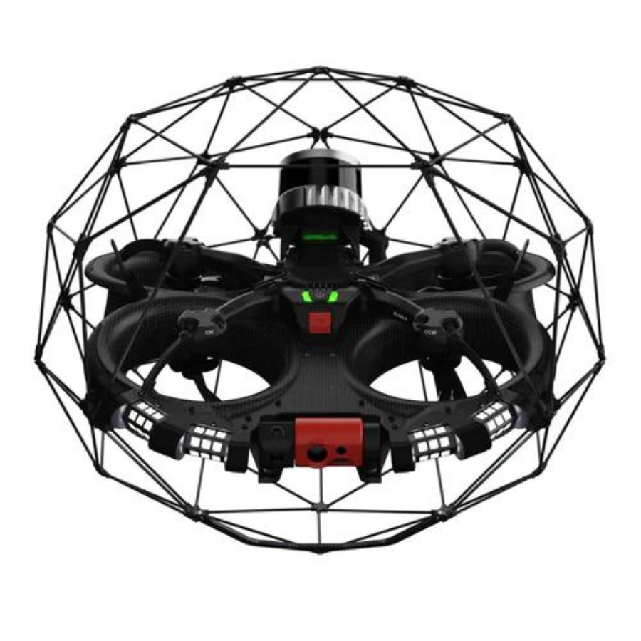

.. GENERATED FROM THE KINESIS VAULT — DO NOT EDIT THIS PAGE DIRECTLY.
.. equipment_id: e0f5a98f-139c-4762-87d0-e65740512f16

============================
Drone - Elios 3 - Flyability
============================

.. container:: equipment-kicker

   Flyability · Elios 3

   Drone - Elios 3 - Flyability

.. list-table:: At a glance
   :class: equipment-facts-table
   :widths: 32 68
   :header-rows: 0

   * - **Manufacturer**
     - Flyability
   * - **Model**
     - Elios 3
   * - **Equipment class**
     - Aerial robot
   * - **Location**
     - C3.B2.029.E (KINESIS CTP)
   * - **Quantity**
     - 1
   * - **Status**
     - Inactive

Overview
--------

The Flyability Elios 3 is a collision-tolerant indoor inspection and mapping drone for confined, cluttered, and GPS-denied spaces. A carbon protective cage lets it fly in contact with structures, while LiDAR SLAM and visual-inertial odometry stabilize it without GPS. The KINESIS system includes the built-in visual inspection payload (4K camera, radiometric thermal camera, and 16,000-lumen lighting), the Surveying LiDAR payload, the UT (ultrasonic thickness) payload, high-capacity batteries, and SDK access for research integration.

Specifications
--------------

.. list-table::
   :class: equipment-spec-table
   :widths: 38 62
   :header-rows: 0

   * - **Mobility**
     - Aerial
   * - **Dimensions**
     - 480 x 380 (W x H) mm
   * - **Weight**
     - 1.96 kg
   * - **Maximum flight time**
     - 11.5 min
   * - **Maximum speed**
     - 7 m/s
   * - **Maximum wind resistance**
     - 7 m/s
   * - **Operating temperature**
     - 0 to 50 °C
   * - **Ingress protection**
     - Splash- and dust-resistant design; LiDAR payload IP68
   * - **Operating environment**
     - Indoor and outdoor
   * - **SLAM capable**
     - Yes
   * - **Battery energy capacity**
     - 99.2 Wh
   * - **Battery voltage**
     - 22.8 V
   * - **Camera resolution**
     - 12.3 MP
   * - **Thermal resolution**
     - 160 x 120 (FLIR Lepton 3.5, radiometric)
   * - **Light output**
     - 16,000 lm
   * - **Additional specifications**
     - Flight time is 11.5 min for the base aircraft and 9.1 min with LiDAR (standard battery). Maximum horizontal speed is 1.5 m/s in Assist mode, 2 m/s in Assist-Sport, 5 m/s in Attitude, and 7 m/s in Sport mode. Maximum safe collision speed is 2 m/s frontal and 2.4 m/s in all directions. Signal or video loss triggers automatic return to signal. Remote-controller range is up to 500 m in direct line of sight. Dimensions include the protective cage. The visual payload records 4K/30 fps video from a 180-degree tiltable pod. The Surveying LiDAR reaches up to 100 m at 1.3 M points/s and supports handheld scanning, with point clouds exported from FARO Connect as LAZ, LAS, or E57. The UT probe measures in single-echo and echo-to-echo modes with +/-0.1 mm accuracy, live A-scans, and location-tagged readings.
   * - **Sensing modalities**
     - RGB, Thermal, LiDAR
   * - **System composition**
     - Visual inspection payload (built-in 4K camera, thermal camera, and lighting), Surveying LiDAR payload (Ouster OS0 128-beam), UT payload in light configuration (Cygnus Instruments dual-element probe), High-capacity batteries, Remote controller with tablet

Typical workflows
-----------------

1. Pre-flight inspection of cage, propellers, payload, and battery charge
2. Confined-space or cluttered-environment visual and thermal inspection with live video
3. LiDAR SLAM mapping and post-processing in FARO Connect
4. Contact ultrasonic thickness measurements with the UT payload
5. Post-flight data review and reporting in Inspector 5
6. Research integration through the Flyability SDK (offboard/onboard control and ROS 2 topics)

.. note::

   These examples are an overview. Follow the current equipment manual and SOP,
   where available, together with the applicable risk assessment and training,
   for the complete procedure.

Software & dependencies
-----------------------

- Flyability Cockpit (controller tablet)
- Inspector 5
- FARO Connect
- Flyability SDK (autoassess_flya_tools)

Safety & operating limits
-------------------------

.. warning::

   - Primary hazards include rotating propellers, lithium-polymer battery fire, and impact or falling from height. The protective cage reduces but does not remove these hazards.
   - Do not fly in environments with known or potential flammable gas.
   - Do not fly over or close to people who are not part of the flight operation.
   - Never leave batteries unattended while charging, and keep them away from flammable materials. Store and transport them in their dedicated case.
   - Outdoor flights require a GCAA drone pilot licence and prior NYUAD EHS approval, and must meet all applicable outdoor flying requirements.

**Access and operational conditions**

- Not yet available to users. Operation requires completion of the Flyability online pilot training course and certificate, an approved local SOP and risk assessment, and commissioning checks. Booking opens once these are complete.

**Approved operating area**

- Indoor areas with the required approvals. Outdoor flights are permitted only where all applicable outdoor flying approvals are in place.

**Environmental limits**

- Designed for indoor and confined-space flight; outdoor flights are subject to the outdoor flying requirements and wind limits.
- Operating temperature 0 to 50 C; batteries must be pre-conditioned between 10 and 40 C before flight.
- Do not fly in rain or standing water; the aircraft is splash- and dust-resistant only.

**Required attire and conditional PPE**

- Long pants.
- Closed-toed shoes.
- Safety goggles.

**Operational controls**

- Permit required

Keywords
--------

``drone`` · ``UAV`` · ``indoor`` · ``outdoor`` · ``inspection`` · ``confined space`` · ``LiDAR`` · ``SLAM`` · ``mapping`` · ``ultrasonic thickness`` · ``thermal``

.. include:: /_includes/contact-lab-manager.inc
